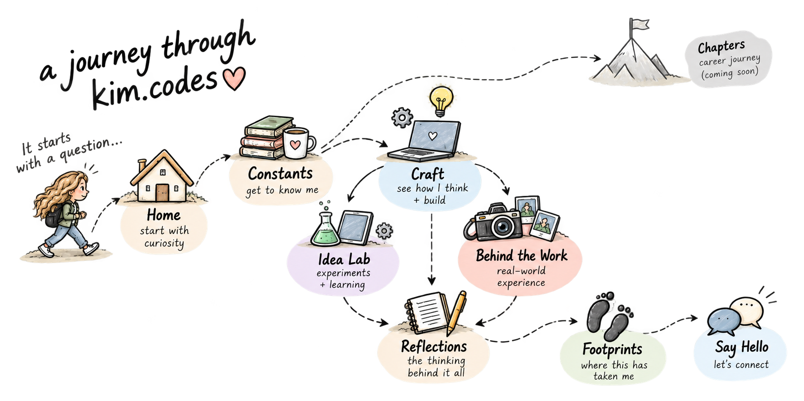

# kim.codes

I wanted to create a small space on the internet to share things like case studies, little experiments I built (and building), and just a general running record of me figuring things out. 

🔗 **live:** [kim.codes](https://kim.codes)

## the build

just plain HTML, CSS, and JavaScript. no frameworks. intentionally.

I wanted to stay close to the fundamentals instead of letting a framework do the thinking for me.

The tradeoff is real. Without a framework, there's no shared component system. Things like the nav get copied across pages and need to be updated manually. It's not the most maintainable approach, and I tend to drift between pages when I'm in the flow. I know... I'm working on it.

## a note on reuse

feel free to explore the code, learn from it, and take inspiration for your own projects. If something here inspires what you build, a little credit or link back to [kim.codes](https://kim.codes) would be appreciated!

Please don't republish my writing, illustrations, or website design as your own.


## the site in 2D



## under the hood 
deliberately simple static site: HTML, CSS, and vanilla JavaScript.

```text

kim.codes/
├── index.html
├── constants.html
├── craft.html
├── lab.html
├── stories.html
├── footprints.html
├── reflections.html
├── contact.html
├── robots.txt
├── sitemap.xml
│
├── labs/
│   ├── studio.html
│   ├── dashboard.html
│   ├── jwt.html
│   └── aiagents.html
│
├── stories/
│   ├── dev-support.html
│   ├── hacktoberfest.html
│   ├── intothecosmos.html
│   └── virtual-tour.html
│
├── essays/
│   ├── 7days.html
│   ├── the-login-problem.html
│   ├── learning-through-apis.html
│   ├── technical-storytelling.html
│   ├── approach.html
│   ├── enablement.html
│   └── insights.html
│
└── assets/
    ├── css/
    ├── js/
    └── img/

```

## worth noting

#### some negatives 
- css is all over the place. stylesheets, inline `<style>` tags... and tons of inconsistencies within the shared files . the downfall of working on the fly and wanting to get all my ideas out into the world.
- colors, spacing, and more are hardcoded in a bunch of spots instead of being centralized properties 

#### but also some positives 
- page transitions run on the native Cross-Document View Transitions API, not js. For a multi-page static site, that's the right tool for the job.
- my idea lab was/is the most fun. I learn through interaction, and I want to stay true that. Most of the labs are based ideas I find fun and interesting. 

## status

under construction. probably always will be. 

## roadmap

tracking as much as I can in [issues](../../issues)

## keeping it healthy

the playful parts of this site shouldn't come at the expense of performance or accessibility. 
I periodically check it: 

- [PageSpeed Insights](https://pagespeed.web.dev/) — performance and Core Web Vitals
- [WAVE](https://wave.webaim.org/) — accessibility

## say hello

[kim.codes/say-hello](https://kim.codes/contact.html)
